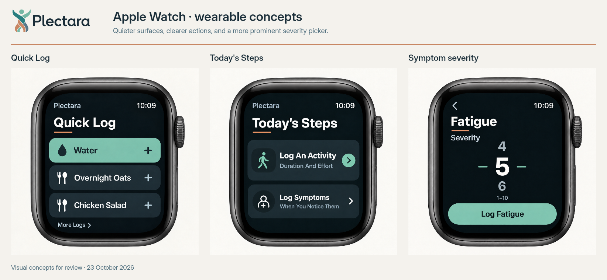
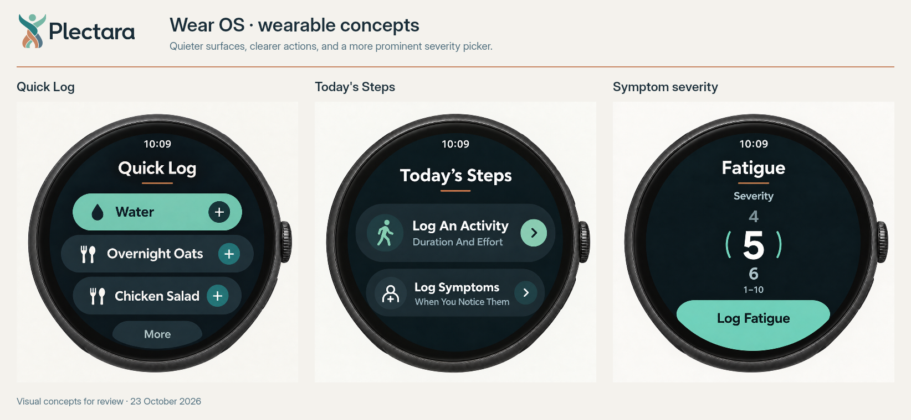

# Wearable Visual Specification

Status: Owner-approved visual direction; implementation specification prepared, unreleased
Owner: Design System Working Group / Native App Engineering
Version: 1.0.0
Last updated: 2026-10-23
Decision: [ADR-0016](../../adr/0016-adopt-wearable-visuals.md), [RFC-0010](../../rfc/0010-wearable-visuals.md)

## Purpose and scope

Define the approved Plectara watchOS and Wear OS appearance for Quick Log, Today's Steps, and symptom severity. Use deep ink backgrounds, quiet slate action surfaces, ivory type, jade primary actions, and a short straight copper line beneath each main heading. The selected severity value is the focal point of the severity screen.

This is a wearable-specific extension of [Capture Widgets](capture-widgets.md), [Buttons](buttons.md), [Iconography](iconography.md), and [Dark Mode & Accessibility](dark-mode.md). It does not change the phone/tablet light or dark palette, the approved yarn and logo assets, widget styling, or the app's PL-213 12-unit section spacing. Watch interfaces use the dark appearance below independently of the paired phone's theme.

The six approved images establish visual direction, wording, hierarchy, and platform shape. They are generated concepts, not screenshots of implemented software. Numeric geometry below is an implementation starting point, not a measurement of those raster images. Native safe areas, readable text, and touch targets take precedence. This specification does not require three new navigation destinations: apply the compositions to the existing sections and focused flows.

## Approved references

The owner approved the final revision with a person-and-health-cross symptom icon, initial capitals on every word of button text, and straight copper header lines on all six designs.

[](../../assets/wearables/plectara/apple-watch-review.png)

[](../../assets/wearables/plectara/wear-os-review.png)

| Platform | Quick Log | Today's Steps | Symptom severity |
| --- | --- | --- | --- |
| Apple Watch | [Full resolution](../../assets/wearables/plectara/mockups/01-apple-quick-log.png) | [Full resolution](../../assets/wearables/plectara/mockups/02-apple-todays-steps.png) | [Full resolution](../../assets/wearables/plectara/mockups/03-apple-severity.png) |
| Wear OS | [Full resolution](../../assets/wearables/plectara/mockups/04-wear-quick-log.png) | [Full resolution](../../assets/wearables/plectara/mockups/05-wear-todays-steps.png) | [Full resolution](../../assets/wearables/plectara/mockups/06-wear-severity.png) |

[Design values](../../assets/wearables/plectara/design-values.json) · [Symptom icon SVG](../../assets/wearables/plectara/icons/symptom-check-in.svg) · [Asset manifest](../../assets/wearables/plectara/manifest.json) · [Contrast evidence](../../assets/wearables/plectara/contrast-report.md)

Reference precedence: written requirements and design values govern implementation; the saved images govern visual intent. Do not copy generated pixels into controls, extract a font or logo from the images, bake in the time, or reproduce the device bezel inside the app. Food names and the value 5 are review examples, not account data or a required quick-item order.

## Wearable color roles

Expose these as scoped `wearable.*` semantic roles in each native theme. The canvas and slate surface are deliberate local overrides; do not replace foundation dark tokens with them. Values are opaque, without a photographic background or gradient. Subtle highlights in the mockups are illustrative; the flat values are the production contract.

| Role | Value | Use |
| --- | --- | --- |
| `canvas` | `#101B22` | Full watch application background |
| `surface` | `#22313A` | Secondary action rows and cards |
| `iconContainer` / `onPrimary` | `#192D38` | Quiet icon backing; text and icons on jade |
| `text` | `#FAF8F4` | Headings, button labels, selected severity, essential icons |
| `textSecondary` | `#B8CBCB` | Supporting copy, range, neighboring picker values |
| `primary` | `#76B7A5` | Prominent action, activity icon, picker indicators |
| `primaryPressed` | `#8DC7B7` | Pressed jade action; keep `onPrimary` foreground |
| `surfacePressed` | `#264C4B` | Pressed secondary row |
| `supportingAccent` | `#287E80` | Wear OS trailing plus-circle backing; ivory icon only |
| `copper` | `#C88764` | Decorative straight header rule |
| `focus` | `#76B7A5` | Focus outline against the dark surround |
| `success` | `#87CBA7` | Acknowledged saved status with check and text |
| `warning` | `#EAC477` | Waiting status with clock and text |
| `critical` | `#FFAAAA` | Rejected/unavailable feedback with explanatory text |
| `border` | `#8DA4A6` | A boundary when needed to identify a control |

A jade Water row means a prominent available action. It does not mean selected, completed, pinned, or already saved. Preserve the user's real pinned/adaptive order; the sample does not permanently promote Water. Selection and save states need their own accessible state and visible indication.

## Shared anatomy and geometry

Use native units: points on watchOS, dp for Wear OS geometry, sp for Wear OS text. These values are starting targets for the first native implementation; record any size-specific adjustments after device review rather than scaling the entire image down.

| Element | Initial target | Constraint |
| --- | --- | --- |
| Content gutter | 12 native units inside the usable region | Increase where the round screen or OS safe area requires it |
| Gap between repeated actions | 8 units | Compact, without overlapping expanded touch targets |
| Gap between sections | 12 units | Do not inherit the phone's larger generic section gaps |
| Internal action padding | 12 units horizontal, 8 vertical | Grow height for wrapping and font scaling |
| Leading icon to label | 8 units | Keep symbol, label and trailing affordance distinct |
| Icon | 24 units, 2-unit outline stroke | A smaller visible glyph never shrinks its hit target |
| Title to copper rule | 4 units | Rule follows the complete heading, including wrapped text |
| Copper rule to content | 8 units | No overlap with text or first action |
| Copper rule | 28 units wide, 2 units high | One solid, level stroke; no wave, fade, gradient or second strand |
| Apple Watch action radius | 12 units | Smooth rounded rectangles; confirmation is a capsule |
| Wear OS action radius | Native pill/round-screen shape | Adapt to the circular content region |
| Hit target | At least 44 × 44 pt on watchOS; 48 × 48 dp on Wear OS | Include the full row; do not overlap adjacent targets |

These hit targets are PL-OS requirements for these flows. Wear OS documentation describes smaller exceptions, but this specification does not use them. Support font scaling and rotary input, then verify with screen readers on actual devices. See [Wear OS accessibility guidance](https://developer.android.com/training/wearables/accessibility).

Use the platform clock once in its safe position. It is OS-owned, live and locale-aware; `10:09` is only a preview value. Keep the reference's horizontal, unobstructed time treatment. Avoid duplicating it in a custom header or placing it against the rim.

### Header accent

Every main screen/section heading in this visual family uses the same short straight copper rule: left-aligned with the heading on Apple Watch and centered under it on Wear OS. Quick Log, Today's Steps and Fatigue all use it. A long or wrapped title does not stretch the rule across the screen. Hide the rule from accessibility semantics.

The jade marks beside the severity value remain functional picker cues. Apple's horizontal marks and Wear OS's curved side marks are distinct from the copper header rule and are retained. Do not apply the straight-line rule to glyphs, circular cases, button shapes or picker indicators.

## Typography and button casing

Retain Inter for custom Plectara text, with scalable native text styles and the [approved system-font fallbacks](../01-brand/typography.md). OS-owned time and controls may use their platform typography. Do not infer a new font family from generated lettering or recreate the canonical logo by typing Plectara. The small Plectara label in the watch mockup is app context, not replacement wordmark artwork.

| Role | Initial watchOS size | Initial Wear OS size | Weight |
| --- | --- | --- | --- |
| Main heading | 22 pt | 20 sp | Semibold |
| Button/action label | 15 pt | 15 sp | Semibold |
| Supporting action text | 12 pt | 12 sp | Medium |
| Selected severity | 40 pt | 40 sp | Semibold |
| Neighboring values | 22 pt | 22 sp | Medium |
| Range label | 12 pt | 12 sp | Medium |

Use a larger selected numeral, not a chart, meter or implied clinical score. Font scaling may enlarge these targets. Wrap labels and allow vertical scrolling before reducing text size or clipping an action. Keep confirmation and Back reachable at the largest supported setting.

**For English wearable button text, capitalize the first letter of every word, including short words.** This applies to primary labels and supporting text inside tappable cards. It is Initial Capitals, not ALL CAPS. It is scoped to wearable actions; surrounding explanatory prose keeps sentence case.

| Location | Required reference wording |
| --- | --- |
| Quick items | `Water`, `Overnight Oats`, `Chicken Salad` |
| Apple overflow | `More Logs` |
| Wear OS overflow | `More` |
| Activity card | `Log An Activity` / `Duration And Effort` |
| Symptom card | `Log Symptoms` / `When You Notice Them` |
| Severity confirmation | `Log Fatigue` for the Fatigue example; `Log {Symptom}` for other supported symptoms |

Author static labels in localization resources. Apply casing only to display labels for first-party action names; preserve user-entered names, acronyms, medication names, brands and units, and never rewrite stored data. Other languages use locale-appropriate casing. A long symptom label can wrap; an accessible full name must remain available.

## Symptom icon

Replace the wavy symptom glyph with a simple front-facing person outline and small health cross centered in the torso. Use an ivory, rounded 2-unit stroke on the existing quiet badge. The icon combines a round head and symmetrical shoulders; it has no face, pulse line, animation, badge count, diagnosis or warning meaning.

The supplied [24-unit SVG](../../assets/wearables/plectara/icons/symptom-check-in.svg) is the vector interpretation of the approved motif for native conversion. Use the same paths/proportions on both platforms, tint through `wearable.text`, and review the converted result at actual watch size. Do not substitute a waveform, thermometer, injury symbol, generic profile avatar, AI sparkle or the brand logo.

Keep the adjacent `Log Symptoms` label. The icon is decorative within that named action and is not separately focusable or announced. This is an approved product icon metaphor, recorded in ADR-0016; it is not a clinical status symbol. The activity action retains its jade walking-person icon.

## Screen contracts

### Quick Log

- Present real quick items as large action rows. The three sample items demonstrate hierarchy; the count and order come from the actual snapshot and supported preferences.
- Use one prominently filled jade action where the product has an appropriate primary choice; other actions use slate. Do not silently reorder items to match the sample.
- Water uses a droplet; meal actions use the existing cutlery metaphor. Preserve meaningful icons for other supported types.
- A plus indicates immediate capture when the item has all required information. A guided or phone-dependent item must expose that destination, with a chevron/phone cue and accessible hint instead of promising an immediate save.
- The entire row is one action. A trailing plus or chevron is part of that action, not a second nested button or duplicate screen-reader stop.
- Apple Watch uses rounded rectangular rows with a low-emphasis `More Logs` action. Wear OS uses pills adapted to the circle and a low-emphasis `More` action near the bottom.
- Overflow opens the supported wider capture list or an explicit phone handoff. It must not be a dead decorative control; implement a real route before showing it.

### Today's Steps

- Present genuine actionable prompts with a leading icon, short action title, supporting label, and trailing chevron. The first action has stronger emphasis through the jade activity icon/chevron; the second uses the new ivory symptom icon.
- `Log An Activity` opens the supported activity flow or phone handoff. `Log Symptoms` opens available symptoms, then severity where supported. These cards do not mark a goal complete merely because they were opened.
- The title means next actions, not pedometer data or a count of completed tasks. Do not invent advice or show the sample prompts unconditionally when no corresponding product data/route exists.
- Apple Watch uses two stacked rounded cards. Wear OS adapts both widths and padding to its circular region; keep the lower card above the clipped edge.
- Preserve existing `Your Goals`, `Due Now`, and other sections and their real values. The mockup is an action-section composition, not authorization to replace goal progress with these two sample cards.

### Symptom severity

- Identify the actual symptom in the heading, followed by the copper rule and `Severity` label. Do not replace the symptom with a generic heading.
- Preserve the existing integer range **1–10**, starting at **5** for a new capture. Keep the native picker, adjacent values and range label; the number shown in the image is not a saved measurement.
- Use ivory for the selected value, readable secondary text for neighbors, and jade selection cues. Do not add `Moderate`, risk bands, health-status colors, radial progress or invented clinical interpretation.
- Changing the picker never saves by itself. `Log {Symptom}` is the single confirmation action; native Back cancels without creating a capture.
- On watchOS support Digital Crown and touch adjustment. On Wear OS support the native picker, rotary input where available, and touch. Expose the symptom, current value, range and adjustable semantics to assistive technology.
- Apple Watch uses a wide jade capsule. Wear OS uses a jade confirmation shape that follows the lower circular edge with its label safely inset. This follows the round-screen shape direction in [Material 3 Expressive for Wear OS](https://developer.android.com/design/ui/wear/guides/get-started/apply); a particular library migration is not required by this visual specification.
- Preserve the existing durable queue, request identity, acknowledgments and deduplication when restyling. Dismissal or a haptic is not evidence that the phone saved the record.

## State and feedback contract

These are required implementation states; the six approved images show default populated states only. Review new state renders before the consuming app ships.

| State | Visual and interaction requirement |
| --- | --- |
| Default | Available action, legible label, real destination; no saved check merely because a row is jade |
| Pressed | Use the scoped pressed fill; keep label and geometry stable; restore after release |
| Focused | Keep platform accessibility focus; an app-drawn focus outline uses jade against the dark surround, not copper |
| Submitting | Preserve the label and show progress; prevent a duplicate submission of the same in-flight action |
| Queued | Clock plus `Waiting for iPhone` or `Waiting for phone`; warning tone; preserve pending count and durable queue |
| Saved | Check plus `Saved` only after acknowledgment; optional platform success haptic; preserve supported repeated captures |
| Needs phone | Phone cue plus `Finish on iPhone` or `Finish on phone`; explain the supported handoff |
| Unavailable | `No longer available` plus an explanation and available recovery path; do not leave an apparently working plus |
| Rejected/error | `Not saved` plus the reason and supported retry/recovery; retry must respect existing request identity rules |
| Empty/setup required | Explain that the phone must be opened for setup/sync; retain supported actions; do not fill with sample data |
| Disabled | Expose disabled semantics and a readable reason when needed; helper text must still meet contrast requirements |

Status messages are explanatory text and retain sentence case. If a status contains an actual recovery button, that button follows the Initial Capitals rule. Keep the distinction between a queued capture and a saved entry across navigation, restart and reconnection. Use haptics as supplementary feedback; reduced-motion settings disable decorative movement without hiding state changes.

## Native integration and migration

Source review on 2026-10-23 found both implementations already using Inter, native severity pickers, a 1–10 range/default 5, capture queues, and explicit queued/saved/needs-phone/unavailable/rejected states. Existing home views include goals and other sections beyond the three concept compositions. This is a bounded source review, not an app-wide functionality audit.

| Consumer path in the Plectara repository | Integration responsibility |
| --- | --- |
| `ios/PlectaraWatch/QuickLogView.swift` | Scope watch palette/type/layout, use the new symptom icon and button casing, replace decorative fading rules with the straight copper accent, retain navigation/sections/picker semantics |
| `ios/PlectaraWatch/WatchCaptureStore.swift` | Preserve queue, acknowledgment and repeat-capture behavior; no persistence change is required by the appearance update |
| `ios/WatchShared/Sources/WatchCaptureContract/WatchCaptureContract.swift` | Retain severity range and request contract |
| `android/wear/src/main/kotlin/com/plectara/app/wear/QuickLogScreen.kt` | Apply scoped native roles, row shapes, typography, icon, casing and round-screen layout; preserve supported back/rotary behavior |
| Existing Android `WearCaptureStore` and shared watch contract | Preserve state semantics, transport and deduplication |

1. Add local wearable theme values and convert the supplied symptom SVG to the native asset format. Use vector rendering, not a cropped raster from the concept.
2. Map each real action to immediate capture, guided capture or explicit phone handoff; wire the overflow route before exposing it.
3. Apply the six compositions to the matching flows. Retain additional goals, due items, symptom choices, empty states and pending-entry feedback.
4. Replace button strings through localization/display formatting. Change `Log Severity` to the contextual `Log {Symptom}` label where it fits; keep severity semantics and range unchanged.
5. Validate default, long-content, large-text and every state above on both platforms. Compare the actual UI with the appropriate reference, not device-case proportions.
6. Publish consuming-app evidence separately. This PL-OS change adds standards and references; it does not claim the watch apps have been updated or tested on devices.

## Accessibility, privacy and acceptance

- Ordinary text must meet 4.5:1 and essential icons/state cues 3:1 against their actual backgrounds. The [contrast fixtures](../../assets/wearables/plectara/contrast-fixtures.json) test the flat role combinations; they do not certify generated-image pixels, native rendering, disabled compositing or device accessibility.
- Copper is decoration, not focus, selection, a required control boundary or the sole status cue. Quiet card fill differences are grouping; labels and affordances identify actions. Add a tested `border` if a boundary is necessary to identify a control.
- Ensure each row is one named action. Announce picker value and range, pending/saved/error status, and contextual handoffs in a sensible focus order. Test VoiceOver and TalkBack, touch and rotary input, and repeated actions after acknowledgment.
- On the smallest supported display and largest supported font setting, no action label, range, numeral or confirmation is clipped. Scrolling is acceptable; tiny type and overlapping targets are not.
- Sensitive labels belong in the active app under existing privacy rules. This approval does not extend the sample symptom details to complications, ambient mode or public notifications. Ambient/system suspension must not trigger a capture.
- Review all six compositions, long/user-authored labels, empty data, offline queue/reconnection, errors, reduced motion, and platform back behavior. Confirm data and existing goal/section visibility are preserved.
- Verify phone/tablet themes, widget assets, global tokens and PL-213 spacing remain unaffected by the scoped wearable implementation.

## Verification and release status

Run from the PL-OS repository:

```bash
.venv/bin/python tooling/check-component-contrast.py --fixtures docs/assets/wearables/plectara/contrast-fixtures.json
.venv/bin/python -m mkdocs build --strict
```

The local asset manifest records SHA-256 values for the six exact approved PNGs, both review boards, the SVG and design/contrast files. Reference images are 1254 × 1254; boards are 1644 × 760. The board logo uses canonical artwork. Preserve these approved references when iterating native implementations.

This additive standard is recorded under Unreleased in the changelog and has not been assigned a new PL-OS bundle release. Documentation may be published from main before a tagged release; consuming-app implementation remains separate. Review evidence must distinguish palette checks and documentation checks from future native/device validation.

## References and version history

- [RFC-0010](../../rfc/0010-wearable-visuals.md) and [ADR-0016](../../adr/0016-adopt-wearable-visuals.md)
- [Capture Widgets](capture-widgets.md), [Buttons](buttons.md), [Iconography](iconography.md), [Spacing](spacing-system.md), [Dark Mode & Accessibility](dark-mode.md)
- [Apple watchOS design guidance](https://developer.apple.com/design/human-interface-guidelines/designing-for-watchos/), [Apple accessibility guidance](https://developer.apple.com/design/human-interface-guidelines/accessibility)
- [Wear OS accessibility](https://developer.android.com/training/wearables/accessibility), [Material 3 Expressive](https://developer.android.com/design/ui/wear/guides/get-started/apply)
- v1.0.0, 2026-10-23: Capture the owner-approved wearable direction, final icon/casing revisions, scoped design values, state preservation, migration and acceptance requirements. Unreleased PL-OS addition.
