# Insights Presentation

Status: Approved direction; implementation pending
Owner: Product and Design System Working Groups
Version: Unreleased
Last updated: 2026-10-25

## Purpose and authority

Define a brief overview of findings on Today, a browsable inventory on Insights, and a detail route for evidence, optional AI explanation, and user-controlled next steps. The approved presentation contract defines the intended experience; native implementation and verification remain required. Clinical rules are unchanged.

This specification supersedes the long-form Today and Insights hierarchy in the v2.6/v2.7 screenshot references. Retain their canonical artwork, theme roles, shell geometry, accessibility requirements, and historical fixtures. Existing capture actions, unrelated Today content, navigation, consent, and analysis eligibility remain governed by their respective contracts.

## Production intent screen references

These app-only design renders show the intended hierarchy at iPhone 16 size: 393 × 852 logical points, exported at 1179 × 2556 pixels. They use Inter, canonical Plectara logo/artwork, app theme roles, vector controls and the current five-tab navigation. The approved woven photo continues behind the entire scrollable region, with the production 55° rotation and cover crop. Text and controls sit on opaque themed reading surfaces. They contain no review-page controls, device frames, surrounding chat text or specification notes.

These are design references, not captures from an implemented native screen. Status-bar values, example entries and findings are fixtures. Native rendering, Dynamic Type, VoiceOver and interaction verification remain required. The written specification controls adaptive behavior; screenshot geometry is not a universal fixed layout. Tap an image to inspect the full-resolution PNG.

| Screen | Light | Dark |
| --- | --- | --- |
| Today highlight | [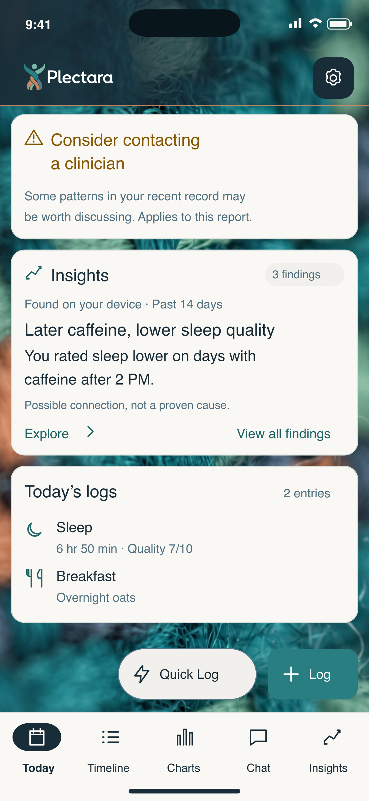{ width="240" }](../../assets/app/insights-presentation/screens/today-light.png) | [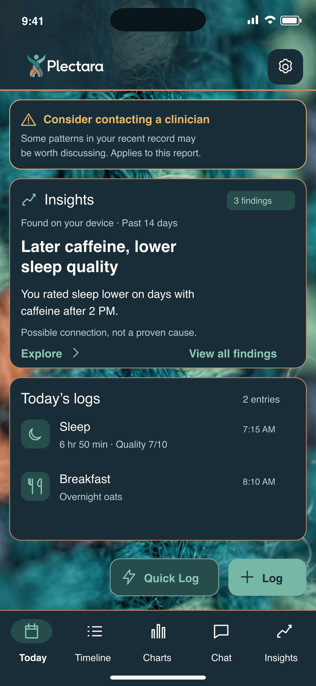{ width="240" }](../../assets/app/insights-presentation/screens/today-dark.png) |
| Insights inventory | [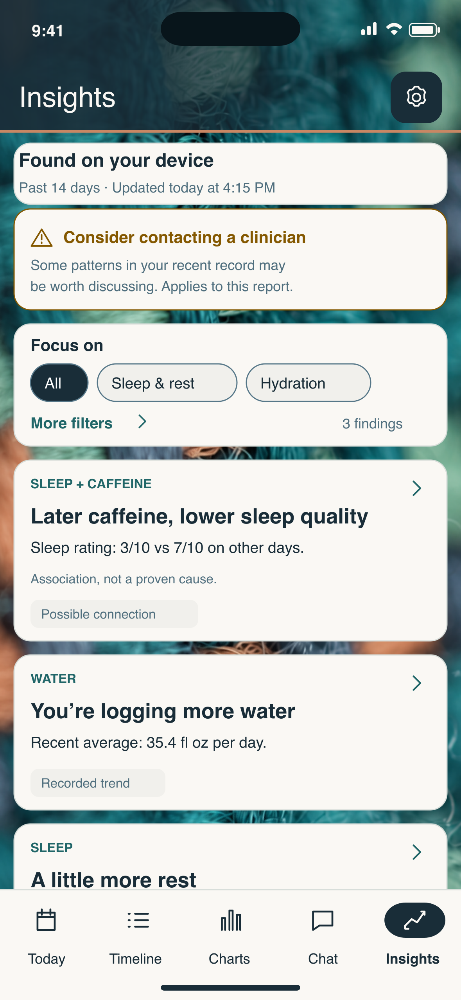{ width="240" }](../../assets/app/insights-presentation/screens/insights-light.png) | [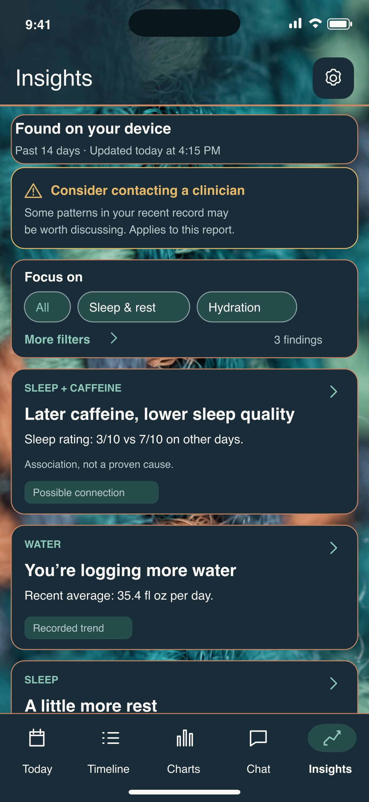{ width="240" }](../../assets/app/insights-presentation/screens/insights-dark.png) |
| More filters sheet | [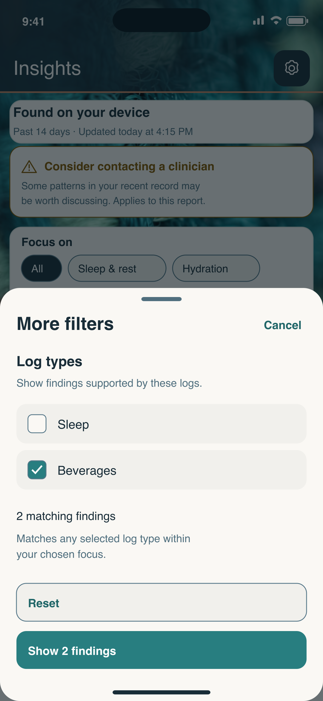{ width="240" }](../../assets/app/insights-presentation/screens/more-filters-light.png) | [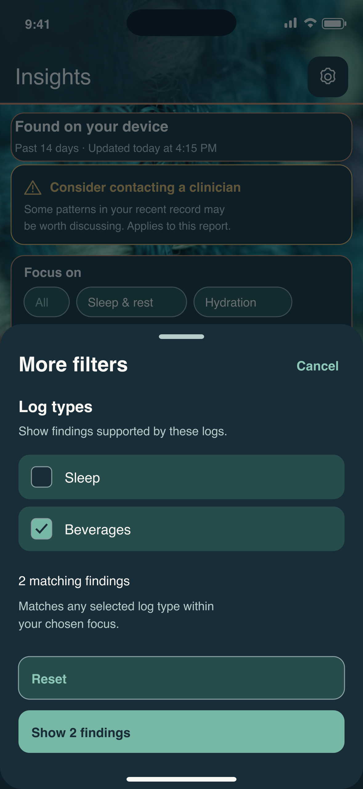{ width="240" }](../../assets/app/insights-presentation/screens/more-filters-dark.png) |
| Finding details | [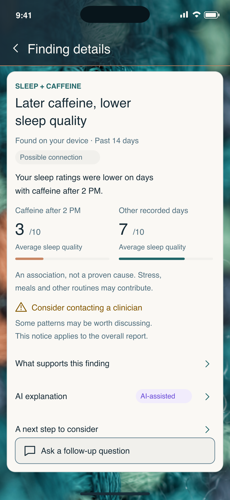{ width="240" }](../../assets/app/insights-presentation/screens/finding-light.png) | [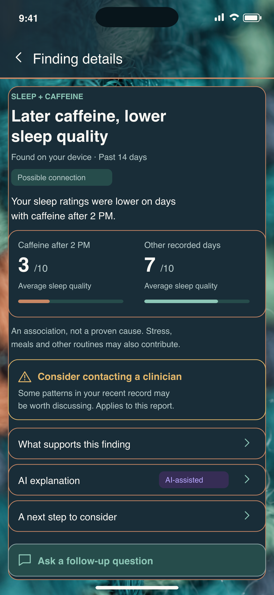{ width="240" }](../../assets/app/insights-presentation/screens/finding-dark.png) |
| Today with active plan | [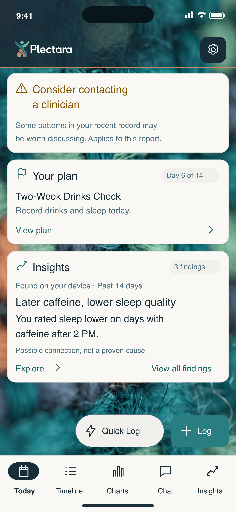{ width="240" }](../../assets/app/insights-presentation/screens/today-plan-light.png) | [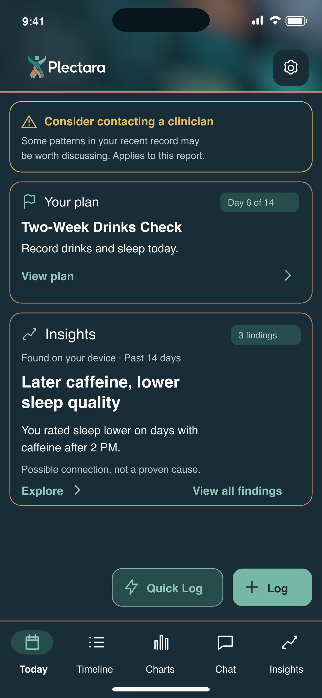{ width="240" }](../../assets/app/insights-presentation/screens/today-plan-dark.png) |
| Insights with AI off | [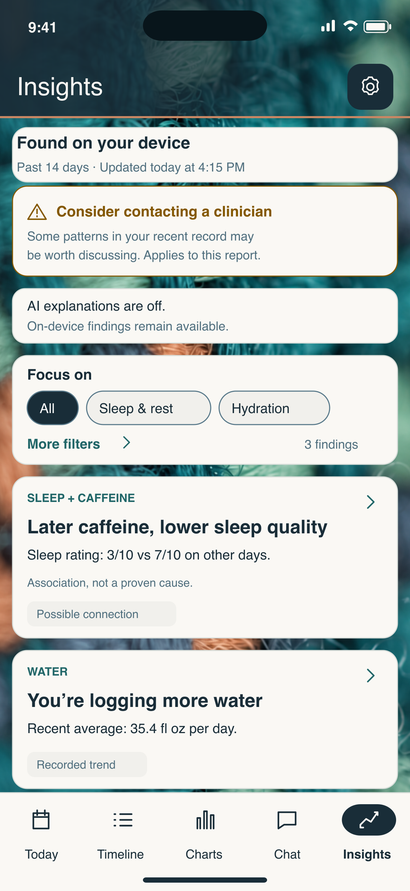{ width="240" }](../../assets/app/insights-presentation/screens/insights-ai-off-light.png) | [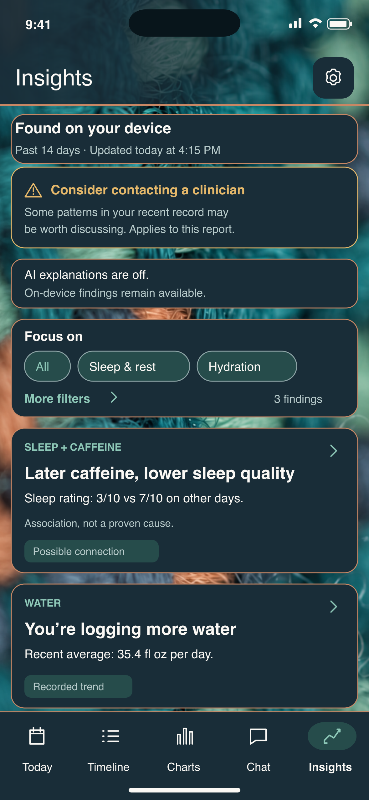{ width="240" }](../../assets/app/insights-presentation/screens/insights-ai-off-dark.png) |

[Editable SVGs and reference metadata](../../assets/app/insights-presentation/screens/references.json) list the source paths, dimensions and checksums for each render. The care notice is a report-level fixture; its placement does not mean caffeine alone triggered it.

## Presentation structure

Use the existing [app shell and theme](../02-design/app-visuals.md) with opaque reading surfaces. The following component structures define the presentation within PL-OS. They specify information order and behavior rather than a fixed screenshot or device size.

### Today insight region

| Order | Component | Presentation rule |
| --- | --- | --- |
| 1 | Applicable care notice | Separate attention surface with icon, full notice and report/finding scope; urgent context leads the region |
| 2 | Highlight heading | Insights label, actual finding count and freshness context |
| 3 | Finding preview | Topic, short factual title and one complete takeaway |
| 4 | Evidence context | Source, analyzed period and material uncertainty adjacent to the claim |
| 5 | Navigation | Explore opens this finding; View all findings opens the inventory |

Render active-plan status as a separate card, with actual title, day/status, concise step summary and View plan. Preserve the existing capture actions and unrelated Today content. Do not copy review-page headings or sample logs into the app.

### Insights inventory card

| Region | Content | Visual treatment |
| --- | --- | --- |
| Inventory header | On-device/source description, analyzed window and last successful analysis | Compact metadata above filters; no full narrative |
| Attention | Applicable care notice and its scope | Independent attention surface before the list |
| Filters | All and available topics; optional separate type selection | Clearly selected, accessible controls with result count |
| Card heading | Topic and factual title | Strongest text hierarchy within the card |
| Card takeaway | One supported observation or comparison | Short readable text, retaining essential qualifiers |
| Card context | Type, period and material uncertainty | Secondary text; distinguish type from confidence |
| Open affordance | Entire card opens the finding | One accessible action with a clear directional cue |

### Finding detail composition

Place the complete claim and evidence context above optional explanations. Present an appropriate comparison only when the analyzer supplies the required values, groups, units and periods. Keep material uncertainty and care context visible before suggested action. Expandable sections contain supporting evidence, optional AI explanation and optional next steps. The [detail anatomy](#finding-detail-anatomy) defines the complete order.

For a connection between caffeine timing and sleep quality, show two explicitly labeled groups on the same sleep-quality scale: days with caffeine after the relevant time, and the comparison days. Populate both values and their coverage from the actual evidence. A missing comparison produces an explanation of missing evidence, not a fabricated chart. This example defines the component's semantics, not a clinical conclusion or fixed numeric fixture.

### Appearance and adaptation

Use ink, teal and restrained semantic accents within existing light/dark reading surfaces. AI Purple identifies the optional AI explanation only. Reserve attention styling for actual care state. The card hierarchy must remain understandable without color, and content must expand for larger text and localization. Device frames, review controls, surrounding presentation copy and specification notes are not interface components.

## Three levels of disclosure

| Surface | User question | Primary content | Primary route |
| --- | --- | --- | --- |
| Today | Is there something useful to notice? | At most one highlighted finding, or a compact state message | Open that finding; view all findings |
| Insights | What patterns can I explore? | Individual eligible findings with type, topic and concise takeaway | Open a finding |
| Finding details | What supports this, and what could I do next? | Claim, evidence, limitations, explanation and optional actions | Supporting entries, follow-up chat, plan preview |

Do not repeat a full AI narrative on Today or above the Insights inventory. A brief card is a complete, understandable summary, not the first characters of a paragraph. The full evidence and explanation remain available in details.

## Today

1. Preserve applicable care notices as an independent, visible part of the insight region. Their urgency and wording come from existing rule state. A high-priority notice leads the region; it cannot be pushed below optional plan or promotional content. A report-level notice must identify its scope rather than implying that the highlighted finding alone triggered it.
2. Show one eligible finding using a topic, short factual headline, one concise takeaway, on-device/source attribution, actual analyzed period, material qualifier, and **Explore**. Show the count of current, non-dismissed findings and **View all findings** when an inventory exists.
3. Target a one- or two-line headline and a one- or two-line takeaway at default text size. These are editorial targets, not fixed heights or truncation limits. Large text, localization and necessary qualifiers expand naturally.
4. Do not show Correlations and Recommendations as separate long lists on Today. Do not place an acknowledgement/reward gate before access to findings.
5. Place active-plan status in its own compact card. Include title, actual day and duration, paused/completed status where applicable, and a concise supported step summary. **View plan** opens the plan, not a generic Insights landing page.
6. Keep Today useful for logging. Preserve existing Quick Log, Log, reminders, progress, and log content without fabricating additional widgets. Action clearance and content insets must prevent coverage of warnings or evidence.

### Highlight selection

Care urgency is evaluated separately from content ranking. From eligible, non-dismissed findings, prefer materially changed or not-yet-reviewed evidence, then relevance to selected goals, then evidence adequacy under the analyzer's documented criteria. Use a stable finding identity as the final tie-breaker. Do not rank by frightening wording, generated confidence, or length of AI text.

Do not show an unrelated tracking statistic merely to fill the slot. When there is no newly useful finding, show the appropriate compact state and retain access to existing findings. A user opening a finding records it as reviewed; this is distinct from saving, dismissing, acknowledging rewards, or completing a plan.

## Insights inventory

- Keep the Insights title and settings action in the existing shell. Use a compact on-device/source description, actual analyzed window and last-successful-analysis timestamp.
- Show applicable care notices before the inventory. Preserve the complete accessible notice and its scope.
- Render one card per eligible finding. Each card contains a topic, type, factual headline, one takeaway, relevant period/coverage qualifier, and a clear open affordance. A card is one accessible action; do not nest unrelated buttons inside it.
- Label the primary filter group **Focus on**. Select **All** initially; use outcome-focused categories rather than log types. Put log-type selection under **More filters**, as defined below. Announce selected state and result count.
- Do not treat a topic as a diagnosis or a direction as a clinical outcome. Use **Possible connection**, **Recorded trend**, **Observation**, or **Goal progress** as appropriate.
- Preserve all eligible findings beyond the first screen. Do not hide findings behind a horizontal carousel or silently discard them to fit a card limit. Pagination must preserve ordering and disclose additional results.
- Preserve filter and scroll state when returning from details. Open a finding by stable identity, not list position.
- Consolidate equivalent observations by finding identity and evidence fingerprint. Do not display the same finding once as a local result and again as an AI result.

### Focus on and More filters

**Focus on** answers “What would I like to understand or improve?” It is a single-select outcome group, not a requirement to create a goal. Supported categories include **Sleep & rest**, **Energy**, **Digestive comfort**, **Mood & stress**, **Activity & recovery**, and **Hydration**. Show only categories represented by eligible findings before secondary filtering. Keep **All** available so unclassified findings remain reachable. The example inventory offers All, Sleep & rest and Hydration because those are its supported outcomes. A hydration logging trend describes recorded behavior, not proof of improved hydration or health.

Map findings to one or more reviewed outcome IDs from structured finding codes and evidence, independently of log types. For example, a caffeine/sleep connection belongs to Sleep & rest and carries both beverage and sleep evidence types. A finding may support several outcomes but appears only once. An actual user-selected goal may prioritize category order; it is not needed to select an outcome. Keep the selected category stable during refresh; if its findings disappear, show the no-match state rather than silently selecting All. Long labels wrap or flow to another row at larger text sizes; do not truncate essential wording.

**More filters** opens an accessible sheet with a **Log types** multi-select group and concise explanation: “Show findings supported by these logs.” Use the app's actual entry-type catalog and familiar labels; display only supported types represented in eligible evidence. Do not confuse log types with finding kinds such as Recorded trend. Unchecked types mean all types. Selecting several log types matches findings supported by **any** selected type; combine that match with the selected outcome using **AND**. A beverage filter must retain a sleep finding supported by beverage entries. Use structured evidence-type IDs, never a keyword search of the headline or AI narrative.

The sheet shows checkboxes, a live matching-result count, **Reset**, **Cancel**, and **Show N findings**. Selections are drafts until applied. Cancel, swipe dismissal or Back discards drafts and restores focus to More filters; Reset clears draft log types without changing Focus on. Show zero findings remains available so no-match behavior is explicit. On apply, announce the result count, close the sheet and return focus to its trigger. Show **More filters · N** and a visible selected-log-type summary when active. Keep the sheet available with AI off; filtering does not require AI or change consent.

Preserve both applied selections and list position when returning from a finding. A deliberate filter change starts the result list at its first matching card. Preserve applicable care notices outside the filtered list. Distinguish **No findings match these filters** from insufficient data; **Clear filters** resets both Focus on to All and all applied log types. Announce the new count without moving focus unexpectedly. All controls meet native touch-target and Dynamic Type requirements; a modal sheet contains focus until dismissed and exposes selected checkbox state.

## Finding detail anatomy

| Order | Content | Visibility |
| --- | --- | --- |
| 1 | Back action, topic, complete factual title, type and source | Always |
| 2 | Exact observation window and analysis timestamp; stale/coverage state | Always |
| 3 | One concise statement and appropriate supported metric visual | Always when available |
| 4 | Material uncertainty, missing-data limitations, relevant care context | Before actions; never accordion-only |
| 5 | **What supports this finding** with counts, periods, comparison basis and supporting entries | Expandable supporting detail |
| 6 | Optional **AI explanation**, locally labeled AI-assisted | Expandable; consent and availability dependent |
| 7 | Optional **A next step to consider** with evidence-appropriate plan or tracking action | Expandable after limitations |
| 8 | Follow-up question, save/dismiss and usefulness/accuracy controls | Clearly labeled, secondary to understanding |

A report-level care notice remains report-level in details. If a specific finding supports a notice, preserve that association explicitly. Do not infer the relationship from co-location. Never weaken or omit urgent wording to meet a short-copy target.

### Visual selection by finding type

| Type | Preferred visual | Guardrail |
| --- | --- | --- |
| Possible connection | Two labeled values or groups on a common scale, with units and cohort context | Show association language, comparison counts and missing coverage when available; no causal arrows |
| Recorded trend | Matched-period comparison or a small real time series | Identify periods, units and baseline; do not invent an earlier value |
| Goal progress | Supported change related to a user-selected goal | No goal-completion ring unless a measurable target and denominator exist |
| Observation | One recorded count/value or short factual statement | Use an unavailable state for missing measurements, not zero |
| Plan status | Actual day/status and supported step completion | Elapsed days are not adherence, efficacy or health improvement |

Use charts only when they clarify the finding. A plain comparison is preferable to a decorative graph. Do not imply a continuous time series from aggregate values. Provide the same information as text for assistive technology. Respect the existing [Charts](../02-design/charts.md) contract for baselines, scales, labels and contrast.

## Finding display contract

The presentation layer must distinguish supplied facts from formatted copy. Each field must be traceable to the analyzer, record store or explicitly labeled explanation.

| Field | Requirement |
| --- | --- |
| Stable finding identity and evidence fingerprint | Identify the logical finding separately from the analyzed evidence version; do not derive identity from AI wording |
| Kind, domain/topics and related goal | Use supported taxonomy; a goal association requires an actual user goal |
| Outcome IDs and supporting log-type IDs | Reviewed many-to-many outcome mapping independent of goals; log-type IDs come from structured evidence and the actual entry catalog; unknown outcomes remain in All |
| Headline and takeaway | Use reviewed templates populated from structured facts; generated summaries require their own validated output contract |
| Source/authorship | Distinguish local detection, imported measurements and optional AI explanation |
| Observation window and generated timestamp | Store and display the actual relevant window, including domain-specific longer lookbacks |
| Metrics and units | Typed values, interpretation of scale and explicit missing values |
| Optional comparison | Named groups/periods, values, method, counts and comparable coverage; omit unsupported comparisons |
| Evidence references | Stable supporting-entry references or a reproducible evidence query, respecting deleted records and permissions |
| Coverage and limitations | Recorded/paired-day counts and missingness when the analyzer provides them; otherwise disclose that coverage is unavailable |
| Confidence/strength | Only when mapped to documented, evaluated criteria; never inferred from assertive wording or sample size alone |
| Care scope and urgency | Existing rule-derived state plus explicit report/finding association |
| Suggested action | Supported action type, eligibility and destination; no automatic plan start or consent change |
| Reviewed, saved and dismissed state | Per-finding state with evidence-version semantics; independent of rewards and care notices |

The current app's `LocalFinding` provides code, domain, kind, label, metrics, evidence-window days, related titles, optional suggestion and device-only controls. It does not guarantee all display fields above. Analyzer-specific adapters may be required. Never recover missing numeric evidence or links by parsing the AI narrative. Missing support must change the presentation, not trigger invented content.

### Authorship and confidence

Use plain attribution such as **Found on your device** for local findings. AI Purple and **AI-assisted** apply to generated explanations, not all findings. **Possible connection** is a type label, not a measured confidence level. AI off, failure or refresh must not change the authorship, evidence or care urgency of an existing local finding.

Follow [Confidence and Evidence](../05-ai/confidence-and-evidence.md). Do not display confidence percentages or high/medium/low badges until a reviewed method supplies them. Include material uncertainty beside the short claim. Detailed methodology may expand; decision-critical limitations may not be hidden exclusively in details or tooltips.

## Interaction contracts

| Action | Required result |
| --- | --- |
| Explore / open card | Open matching detail route and evidence version; Back restores origin state |
| View all findings | Open Insights; do not mark every finding reviewed |
| View supporting entries | Open timeline filtered to supporting evidence, with filter description and clear exit; unavailable/deleted references produce an explanation |
| Ask a follow-up | Open supported chat with the finding context and editable suggested question; preserve cloud exclusions and consent boundaries |
| Explore a tracking plan | Open eligible plan preview; show scope and requirements; starting remains explicit |
| View active plan | Open that plan's actual state and steps; paused, completed and unavailable progress are distinct |
| Save | Persist a bookmark independently of viewed/dismissed status; unavailable findings retain their historical context |
| Dismiss | Remove the selected evidence version from routine presentation, offer undo, and retain a route to dismissed items |
| Do not show this again | Explicitly suppress the logical finding until the user reverses that preference; do not silently apply this stronger action via Dismiss |
| Feedback | Distinguish not useful, not accurate and safety concern; no automatic alteration of evidence or clinical rules |

A materially changed evidence version may reappear after a normal Dismiss. An explicit recurrence suppression persists. Neither action suppresses applicable report-level or urgent care notices. A dismissed finding must not become “new” because an AI explanation was reworded.

Chat must preserve existing device-only domains and opt-in exclusions. The context must not silently expand from permitted structured findings to full diary notes, photos or excluded entries. When an eligible finding cannot be shared, explain the limitation and keep local details accessible.

## State matrix

| State | Today | Insights and details | Actions |
| --- | --- | --- | --- |
| Initial analysis loading | Compact loading status; preserve logging | Stable skeleton/status without fabricated findings | No false progress percentage |
| Insufficient evidence | Explain which missing records would support the relevant question | No invented finding or empty comparison chart | Relevant logging entry point; no universal entry-count threshold invented by UI |
| Analysis complete with no eligible findings | State that no clear patterns were found in the reviewed window | Distinguish from not analyzed and insufficient data | Continue normal use; do not require more logging without a reason |
| No newly changed findings | Compact status and access to earlier findings | Existing inventory remains browsable; no repeated “new” badge | Review earlier findings |
| AI turned off | Local overview unaffected | Local evidence remains available; explanation states it is off | AI preferences; enabling remains explicit consent |
| AI unavailable/offline | Local overview unaffected | Preserve facts and any separately dated last-successful explanation; unavailable AI is labeled | Explicit retry when appropriate; no filler narrative |
| Local analysis failed | State failure without replacing the last successful result | Retained results show their original dates and stale status | Retry; logging remains available |
| Older findings | Stale label before any retained claim | Original observation window and analyzed date remain visible | Refresh local analysis; do not imply cloud AI is also refreshed |
| Filter has no matches | Not applicable | Empty filter result distinct from empty inventory | Clear filters |
| Evidence removed or inaccessible | Re-evaluate eligibility before highlighting | Explain unavailable support; do not show a chart based on inaccessible evidence | Return to current inventory; refresh as appropriate |
| Active/paused/completed plan | Actual title, day/status and concise step summary | Plan details retain real completion and comparison eligibility | Preview/manage; never infer success from elapsed time |

Each analyzer defines evidence eligibility and stale-after rules. The display layer consumes them; it must not invent a universal age cutoff. Store the last successful analysis separately from attempt time and AI generation time.

## Accessibility and responsive behavior

- Preserve the canonical woven backdrop, header rule and opaque reading surfaces. Support System, Light and Dark. Reduce decoration under accessibility settings as defined by the app visual contract.
- Use native semantic headings, buttons, selected filters, expanded disclosures and navigation. Announce a card's type, claim, period and open action without reading decorative glyphs.
- Use minimum 44-point touch targets. Support keyboard focus, visible focus styling and logical reading order.
- Dynamic Type and localization must expand cards vertically. Phone-sized fixed heights and the review prototype's scaled canvas are not production geometry.
- Supply text equivalents for every comparison, including direction, values, units and periods. Never encode significance, selection or care urgency with color alone.
- Preserve reduced-motion behavior, scroll position, focus restoration and bottom safe-area clearance. Expanding evidence must not move focus to an unrelated card.

## Acceptance criteria

1. Today renders no more than one highlighted finding and no full AI narrative; all eligible findings remain reachable on Insights.
2. A compact card and its detail route resolve to the same finding identity, evidence version, source, observation window and values.
3. Material uncertainty and applicable care notices remain visible before optional action. Filtering, dismissing or AI toggles cannot remove required care context.
4. Every comparison has actual groups/periods, labeled units and supported values. Missing values, unavailable confidence or absent baselines never become zero or fabricated percentages.
5. Reviewed, changed, unchanged, saved, dismissed and recurrence-suppressed fixtures produce the specified ranking and disclosure behavior.
6. Every state in the matrix is reviewed in light/dark appearance, default and enlarged text. No card, warning or bottom action is clipped or obscured.
7. Focus on uses outcome categories and works without a saved goal. More filters uses evidence log types with OR within that group and AND with the outcome. Verify a caffeine/sleep finding survives Sleep & rest plus Beverages, several outcome tags never duplicate a card, AI off still permits filtering, sheet Cancel discards drafts, Reset affects only draft log types, and Clear filters resets both groups. Care notices remain visible for zero results. Filters announce selection and result count; Back restores origin, selected filters and scroll position. Evidence disclosures are operable by keyboard and VoiceOver.
8. Plan preview/start, chat opt-in and feedback remain explicit. No presentation action silently changes logging preferences, consent or clinical rules.
9. Local findings remain inspectable with AI off or unavailable. Device-only findings and excluded records never enter cloud context through the new detail route.
10. Approved native screenshots and interaction evidence replace the prototype as implementation verification; browser review alone does not establish native accessibility or production readiness.

## Dependencies and migration

Implement display adapters and evidence navigation before replacing the existing card. Preserve actual local findings and rule-derived care state throughout migration. Validate representative connection, trend, goal and observation fixtures plus missing/partial evidence. Retain the historical screenshot assets as versioned references.

The controlling references are [Insights and Correlations](insights-and-correlations.md), [App Visual Specification](../02-design/app-visuals.md), [Progress and Disclosure](../02-design/progress-and-disclosure.md), [Insight Types](../05-ai/insight-types.md), [Confidence and Evidence](../05-ai/confidence-and-evidence.md), and [Hybrid Local Findings](../../adr/0010-hybrid-local-findings-optional-llm.md). This specification introduces no clinical thresholds or new cloud-sharing permissions.

## Supplementary design exploration

The [interactive prototype](../../assets/app/insights-presentation/index.html) is an optional exploration aid. Its scenario selector, scaled phone frames, seeded values and surrounding notes support review only; they are not normative PL-OS content or native implementation evidence. The component structures, behavior rules and acceptance criteria in this specification take precedence. Historical review captures remain archived assets and are not embedded as the specification's visual contract.

## Version History

- 2026-10-25: Replaces primary log-type chips with outcome-focused Focus on; specifies evidence-based More filters sheet, matching, state and accessibility behavior, and adds light/dark sheet references.
- 2026-10-25: Adds app-only production-intent renders for Today, Insights, finding details, active-plan and AI-off states in light/dark appearance; includes editable vector sources and full-resolution exports.

- 2026-10-25: Replaces the embedded review-page capture with native PL-OS component structures and presentation rules; separates the supplementary prototype from normative specification content.

- 2026-10-25: Approved three-level presentation, visual references, display contract, state matrix and acceptance criteria; implementation pending.
